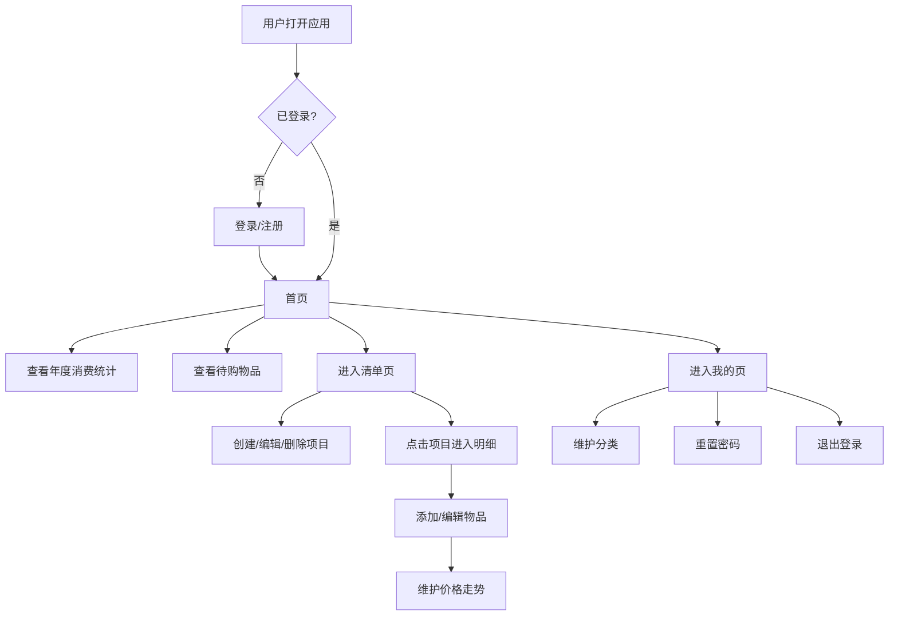

# 购物清单应用 PRD

## 1. 产品概述
一款面向移动端的购物清单管理 H5 应用，帮助用户按项目记录购物明细、跟踪价格走势、统计年度消费。前后端分离架构，开发时前后端分别起服务，生产部署时由后端处理前端静态文件，使用 node:sqlite 作为数据库。
- 目标用户：有购物清单管理需求、希望追踪消费与价格走势的个人用户
- 核心价值：将零散的购物记录按项目聚合，提供年度消费统计与价格趋势可视化

## 2. 核心功能

### 2.1 用户角色
| 角色 | 注册方式 | 核心权限 |
|------|----------|----------|
| 普通用户 | 用户名+密码注册 | 管理自己的项目、物品明细、分类与价格走势 |

### 2.2 功能模块
1. **登录注册页**：用户名密码登录、注册
2. **首页**：年度消费统计、待购物品明细
3. **清单页**：按项目聚合展示、添加项目、项目编辑删除
4. **项目明细页**：物品明细列表、添加/编辑物品、价格走势维护
5. **我的页**：用户信息卡片、分类维护入口、重置密码、退出登录
6. **分类维护页**：分类的增删改查

### 2.3 页面详情
| 页面名称 | 模块名称 | 功能描述 |
|----------|----------|----------|
| 登录页 | 登录表单 | 用户名密码登录，跳转注册 |
| 注册页 | 注册表单 | 用户名密码注册，跳转登录 |
| 首页 | 年度消费统计 | 卡片展示今年总消费金额 |
| 首页 | 待购物品明细 | 列表展示未购买物品，按项目分组 |
| 清单页 | 项目列表 | 按项目聚合展示，显示项目下物品数和总花费 |
| 清单页 | 添加项目 | 右下角悬浮按钮，弹出表单添加项目 |
| 清单页 | 项目编辑/删除 | 点击项目名称弹出操作菜单，可编辑或删除 |
| 项目明细页 | 物品明细列表 | 展示项目下所有物品及其购买状态 |
| 项目明细页 | 添加/编辑物品 | 表单包含名称、分类、是否购买、价格、平台、店铺、备注 |
| 项目明细页 | 价格走势 | 列表展示价格、日期、平台，可增删 |
| 我的页 | 用户信息卡片 | 展示当前用户名等信息 |
| 我的页 | 分类维护入口 | 点击跳转到分类维护页 |
| 我的页 | 重置密码 | 弹窗输入旧密码和新密码 |
| 我的页 | 退出登录 | 清除登录状态返回登录页 |
| 分类维护页 | 分类列表 | 展示所有分类 |
| 分类维护页 | 添加/编辑/删除分类 | 对分类进行增删改 |

## 3. 核心流程

### 3.1 用户购物记录流程
用户注册登录 → 进入首页查看统计 → 在清单页创建项目 → 进入项目明细添加物品 → 标记购买状态并记录价格 → 在价格走势中维护历史价格

### 3.2 流程图

## 4. 用户界面设计

### 4.1 设计风格
- **主色调**：温暖橙色 `#FF6B35` 作为主色，搭配深灰 `#1F2937` 文字与米白 `#FAFAFA` 背景
- **辅助色**：薄荷绿 `#10B981`（已购买）、琥珀黄 `#F59E0B`（待购买）
- **按钮风格**：圆角胶囊按钮，主按钮橙色填充，次按钮描边
- **字体**：标题使用思源黑体，正文使用系统默认无衬线字体
- **布局风格**：移动端卡片式布局，底部 Tab 导航栏
- **图标风格**：线性图标，来自 lucide-react

### 4.2 页面设计概览
| 页面名称 | 模块名称 | UI 元素 |
|----------|----------|----------|
| 登录页 | 登录表单 | 居中卡片、圆角输入框、橙色主按钮、底部注册链接 |
| 首页 | 统计卡片 | 大号金额数字、渐变背景、月份对比 |
| 首页 | 待购物品列表 | 分组卡片、左侧色条标识、状态标签 |
| 清单页 | 项目卡片 | 圆角卡片、物品计数、总花费、点击进入 |
| 清单页 | 悬浮按钮 | 右下角圆形 FAB、橙色填充、加号图标 |
| 项目明细页 | 物品列表 | 卡片式、购买状态 Switch、价格高亮 |
| 项目明细页 | 价格走势 | 时间线样式、价格趋势箭头 |
| 我的页 | 信息卡片 | 头像、用户名、圆形渐变背景 |
| 我的页 | 功能列表 | 列表项、右箭头、分隔线 |

### 4.3 响应式设计
- 移动端优先设计，最大宽度 480px 居中
- 触摸优化：按钮最小点击区域 44px
- 底部导航栏适配安全区域

## 5. 技术约束
- 前端：React 19 + TypeScript + Vite + Tailwind CSS + Zustand + React Router
- 后端：Node.js + Express + TypeScript（ESM）
- 数据库：node:sqlite
- 开发模式：前后端分别起服务（前端 5173、后端 3000）
- 生产模式：后端服务静态文件，单一端口部署
- 所有依赖使用最新版本
