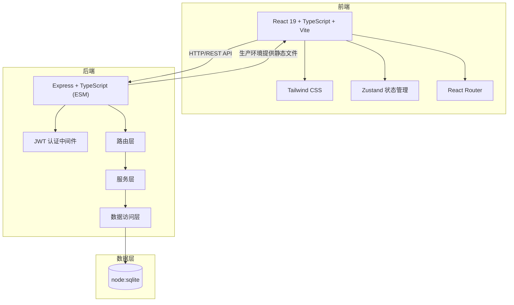
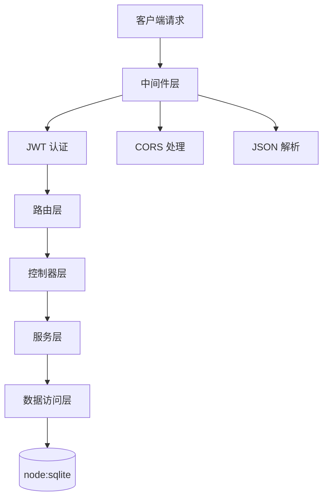
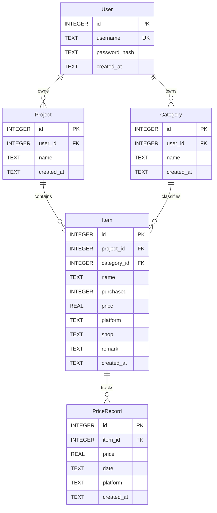

# 购物清单应用技术架构文档

## 1. 架构设计



## 2. 技术说明
- **前端**：React 19 + tailwindcss + vite + react-router-dom + zustand
- **初始化工具**：vite-init (react-express-ts 模板)
- **后端**：Express + TypeScript（ESM 格式）
- **数据库**：node:sqlite（Node.js 内置 SQLite 驱动）
- **认证**：JWT Token，存储于 localStorage

## 3. 路由定义
| 路由 | 用途 |
|------|------|
| `/login` | 登录页 |
| `/register` | 注册页 |
| `/` | 首页（年度统计 + 待购物品） |
| `/list` | 清单页（项目列表） |
| `/project/:id` | 项目明细页 |
| `/profile` | 我的页 |
| `/categories` | 分类维护页 |

## 4. API 定义

### 4.1 认证相关
| 方法 | 路径 | 说明 | 请求体 | 响应 |
|------|------|------|--------|------|
| POST | `/api/auth/register` | 注册 | `{ username, password }` | `{ token, user }` |
| POST | `/api/auth/login` | 登录 | `{ username, password }` | `{ token, user }` |
| PUT | `/api/auth/password` | 重置密码 | `{ oldPassword, newPassword }` | `{ success }` |
| GET | `/api/auth/me` | 获取当前用户 | - | `{ user }` |

### 4.2 项目相关
| 方法 | 路径 | 说明 | 请求体 | 响应 |
|------|------|------|--------|------|
| GET | `/api/projects` | 获取项目列表 | - | `Project[]` |
| POST | `/api/projects` | 创建项目 | `{ name }` | `Project` |
| PUT | `/api/projects/:id` | 编辑项目 | `{ name }` | `Project` |
| DELETE | `/api/projects/:id` | 删除项目 | - | `{ success }` |

### 4.3 物品明细相关
| 方法 | 路径 | 说明 | 请求体 | 响应 |
|------|------|------|--------|------|
| GET | `/api/projects/:id/items` | 获取项目下物品 | - | `Item[]` |
| POST | `/api/projects/:id/items` | 添加物品 | `ItemInput` | `Item` |
| PUT | `/api/items/:id` | 编辑物品 | `ItemInput` | `Item` |
| DELETE | `/api/items/:id` | 删除物品 | - | `{ success }` |

### 4.4 分类相关
| 方法 | 路径 | 说明 | 请求体 | 响应 |
|------|------|------|--------|------|
| GET | `/api/categories` | 获取分类列表 | - | `Category[]` |
| POST | `/api/categories` | 创建分类 | `{ name }` | `Category` |
| PUT | `/api/categories/:id` | 编辑分类 | `{ name }` | `Category` |
| DELETE | `/api/categories/:id` | 删除分类 | - | `{ success }` |

### 4.5 价格走势相关
| 方法 | 路径 | 说明 | 请求体 | 响应 |
|------|------|------|--------|------|
| GET | `/api/items/:id/prices` | 获取价格走势 | - | `PriceRecord[]` |
| POST | `/api/items/:id/prices` | 添加价格记录 | `PriceInput` | `PriceRecord` |
| DELETE | `/api/prices/:id` | 删除价格记录 | - | `{ success }` |

### 4.6 统计相关
| 方法 | 路径 | 说明 | 请求体 | 响应 |
|------|------|------|--------|------|
| GET | `/api/stats/year` | 年度消费统计 | - | `{ total, byMonth }` |
| GET | `/api/stats/pending` | 待购物品明细 | - | `PendingItem[]` |

### 4.7 TypeScript 类型定义
```typescript
interface User {
  id: number;
  username: string;
  created_at: string;
}

interface Project {
  id: number;
  user_id: number;
  name: string;
  created_at: string;
  item_count?: number;
  total_spent?: number;
}

interface Category {
  id: number;
  user_id: number;
  name: string;
  created_at: string;
}

interface Item {
  id: number;
  project_id: number;
  category_id: number | null;
  name: string;
  purchased: boolean;
  price: number | null;
  platform: string | null;
  shop: string | null;
  remark: string | null;
  created_at: string;
  category?: Category;
  prices?: PriceRecord[];
}

interface PriceRecord {
  id: number;
  item_id: number;
  price: number;
  date: string;
  platform: string | null;
  created_at: string;
}

interface ItemInput {
  category_id?: number | null;
  name: string;
  purchased: boolean;
  price?: number | null;
  platform?: string | null;
  shop?: string | null;
  remark?: string | null;
}

interface PriceInput {
  price: number;
  date: string;
  platform?: string | null;
}
```

## 5. 服务端架构图



## 6. 数据模型

### 6.1 数据模型定义



### 6.2 数据定义语言 (DDL)

```sql
-- 用户表
CREATE TABLE IF NOT EXISTS users (
    id INTEGER PRIMARY KEY AUTOINCREMENT,
    username TEXT NOT NULL UNIQUE,
    password_hash TEXT NOT NULL,
    created_at TEXT NOT NULL DEFAULT (datetime('now'))
);

-- 项目表
CREATE TABLE IF NOT EXISTS projects (
    id INTEGER PRIMARY KEY AUTOINCREMENT,
    user_id INTEGER NOT NULL,
    name TEXT NOT NULL,
    created_at TEXT NOT NULL DEFAULT (datetime('now')),
    FOREIGN KEY (user_id) REFERENCES users(id) ON DELETE CASCADE
);

-- 分类表
CREATE TABLE IF NOT EXISTS categories (
    id INTEGER PRIMARY KEY AUTOINCREMENT,
    user_id INTEGER NOT NULL,
    name TEXT NOT NULL,
    created_at TEXT NOT NULL DEFAULT (datetime('now')),
    FOREIGN KEY (user_id) REFERENCES users(id) ON DELETE CASCADE
);

-- 物品明细表
CREATE TABLE IF NOT EXISTS items (
    id INTEGER PRIMARY KEY AUTOINCREMENT,
    project_id INTEGER NOT NULL,
    category_id INTEGER,
    name TEXT NOT NULL,
    purchased INTEGER NOT NULL DEFAULT 0,
    price REAL,
    platform TEXT,
    shop TEXT,
    remark TEXT,
    created_at TEXT NOT NULL DEFAULT (datetime('now')),
    FOREIGN KEY (project_id) REFERENCES projects(id) ON DELETE CASCADE,
    FOREIGN KEY (category_id) REFERENCES categories(id) ON DELETE SET NULL
);

-- 价格走势表
CREATE TABLE IF NOT EXISTS price_records (
    id INTEGER PRIMARY KEY AUTOINCREMENT,
    item_id INTEGER NOT NULL,
    price REAL NOT NULL,
    date TEXT NOT NULL,
    platform TEXT,
    created_at TEXT NOT NULL DEFAULT (datetime('now')),
    FOREIGN KEY (item_id) REFERENCES items(id) ON DELETE CASCADE
);

-- 索引
CREATE INDEX IF NOT EXISTS idx_projects_user_id ON projects(user_id);
CREATE INDEX IF NOT EXISTS idx_categories_user_id ON categories(user_id);
CREATE INDEX IF NOT EXISTS idx_items_project_id ON items(project_id);
CREATE INDEX IF NOT EXISTS idx_items_category_id ON items(category_id);
CREATE INDEX IF NOT EXISTS idx_prices_item_id ON price_records(item_id);
```

## 7. 部署架构
- **开发模式**：前端 `vite dev` 运行在 5173 端口，后端 `tsx watch` 运行在 3000 端口，前端通过 proxy 代理 API 请求
- **生产模式**：前端 `vite build` 生成静态文件到 `dist` 目录，后端 Express 通过 `express.static` 托管 `dist` 目录，单一端口 3000 提供服务
